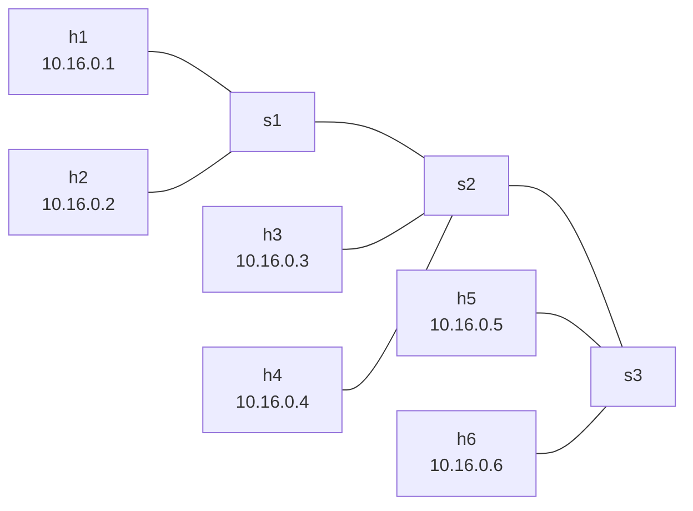

# WIC3005 — My Network, Built from Data

This project applies concepts from Weeks 1 and 2 of WIC3005 to describe, validate, build, and document a network using a shared data model.

The same `topology.yaml` file produces two outputs:

- A running network in Mininet.
- A generated web page containing the network topology, test evidence, and learning reflections.

## Network Design

The network contains **3 switches, 6 hosts, and 8 links**. The switches form a chain, with two hosts connected to each switch.



| Host | IPv4 address | IPv6 address | Connected switch |
|---|---|---|---|
| h1 | `10.16.0.1/24` | `fd00:2616::1/64` | s1 |
| h2 | `10.16.0.2/24` | `fd00:2616::2/64` | s1 |
| h3 | `10.16.0.3/24` | `fd00:2616::3/64` | s2 |
| h4 | `10.16.0.4/24` | `fd00:2616::4/64` | s2 |
| h5 | `10.16.0.5/24` | `fd00:2616::5/64` | s3 |
| h6 | `10.16.0.6/24` | `fd00:2616::6/64` | s3 |

The allocated address blocks are `10.16.0.0/16` and `fd00:2616::/32`. Within these blocks, the hosts use the IPv4 subnet `10.16.0.0/24` and IPv6 subnet `fd00:2616::/64`.

The network uses Mininet's `LinuxBridge` switches with `controller=None`.

## Project Files

```text
.
├── README.md
└── netlab/
    ├── topology.yaml       # Network description
    ├── topology.json       # Alternative JSON serialisation
    ├── bad.yaml            # Invalid topology for validation testing
    ├── build_topo.py       # Validate and build the Mininet network
    ├── make_page.py        # Validate data and generate the web page
    ├── page.yaml           # Page metadata and learning reflections
    ├── docs/
    │   └── index.html      # Generated web page
    └── evidence/
        ├── pingall.txt
        ├── neigh.txt
        ├── macs.txt
        ├── dad.txt
        └── check.txt
```

## One Data Model, Two Outputs

`topology.yaml` defines the student ID suffix, switches, hosts, IPv4 and IPv6 addresses, and links.

`build_topo.py` reads this description to create the network. `make_page.py` reads the same description to generate the host table, link list, and Mermaid topology diagram.

The web page also incorporates test evidence from `evidence/` and written reflections from `page.yaml`.

YAML and JSON provide two serialisation formats for the same network data model.

## Validation

Both scripts use the same validation functions before producing their output:

- `check_mine()` checks the student ID suffix, address validity, and membership in the allocated address blocks.
- `check()` checks for duplicate host IP addresses and links that reference unknown nodes.

If these checks find a problem, the script reports it and stops.

The invalid topology demonstrates errors such as:

```text
PROBLEM: h2 and h1 both use 10.16.0.1
PROBLEM: h2 and h1 both use fd00:2616::1
PROBLEM: link [h6, s9] refers to unknown node 's9'
Fix the description and try again.
```

## Run the Network

Use a Linux lab environment or container with Python 3, PyYAML, Mininet, and Linux bridge utilities installed. Mininet requires root privileges.

Clone the repository and enter the project directory:

```bash
git clone https://github.com/AnJunli1029/WIC3005-Programable-Network.git
cd WIC3005-Programable-Network/netlab
```

Build the network:

```bash
sudo python3 build_topo.py topology.yaml
```

If the lab container already runs as root, `sudo` can be omitted.

At the Mininet prompt, test connectivity and inspect network state:

```text
pingall
h1 ping -6 -c 1 fd00:2616::2
h1 ip neigh
sh brctl showmacs s1
exit
```

To test rejection of invalid data:

```bash
python3 build_topo.py bad.yaml
```

Run the commands from `netlab/` so that relative file paths resolve correctly.

## Recorded Test Evidence

| Evidence | Observation |
|---|---|
| [IPv4 and IPv6 connectivity](netlab/evidence/pingall.txt) | IPv4 `pingall` recorded 0% dropped, with 30/30 received; an IPv6 ping from h1 to h2 also succeeded. |
| [Neighbour table](netlab/evidence/neigh.txt) | Records IPv4 ARP and IPv6 Neighbour Discovery entries on h1. |
| [Switch MAC table](netlab/evidence/macs.txt) | Shows s1 learning h1 and h2 on local ports, and h3–h6 through its link to s2. |
| [Duplicate address experiment](netlab/evidence/dad.txt) | IPv6 marked the duplicate address `dadfailed tentative`; the IPv4 duplicate was added as a secondary address in this experiment. |
| [Validation errors](netlab/evidence/check.txt) | Demonstrates detection of duplicate IP addresses and a link to an unknown switch. |

These files record previous experiments. Rerun the tests after changing the topology.

## Generate the Web Page

From `netlab/`, run:

```bash
python3 make_page.py topology.yaml
```

The output is:

```text
netlab/docs/index.html
```

The generator imports validation functions from `build_topo.py`, so its Python environment also needs Mininet installed.

Before generating the page, ensure the `repository` field in `page.yaml` is:

```yaml
repository: https://github.com/AnJunli1029/WIC3005-Programable-Network
```

The generated page includes the network summary, host addresses, links, topology diagram, test evidence, and learning reflections. Its Mermaid diagram loads a JavaScript module from jsDelivr.

## Publish with GitHub Pages

The generator writes to `netlab/docs/`. For branch-based publishing, copy the generated page into a `docs/` directory at the repository root.

From `netlab/`, run:

```bash
mkdir -p ../docs
cp docs/index.html ../docs/index.html
```

Commit and push the root `docs/index.html`, then configure the repository:

1. Open **Settings → Pages**.
2. Select **Deploy from a branch**.
3. Select the **main** branch and **/docs** folder.
4. Click **Save**.
5. Wait for deployment and open the URL shown by GitHub Pages.

After future topology or documentation changes, regenerate the page and copy the updated output into the root `docs/` directory before committing.

## Assignment Submission

Submit the deployed **GitHub Pages URL on Spectrum**.

Before submitting, confirm that the published page opens successfully and displays the topology diagram, evidence, and reflections.

## Learning Outcomes

This project demonstrates:

- Describing a network as structured data.
- Checking configuration errors before building a network.
- Building and documenting a network from the same description.
- Observing MAC learning, ARP, and IPv6 Neighbour Discovery.
- Comparing IPv4 and IPv6 behaviour during a duplicate address experiment.
- Using Git for version history and GitHub Pages for publishing documentation.
